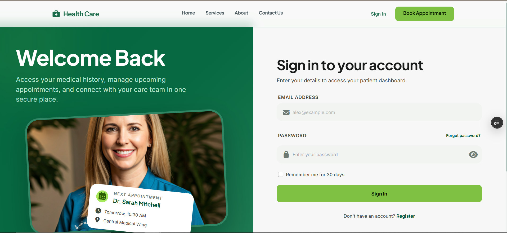
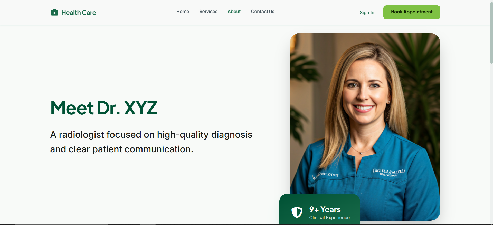

# 🚀 Doctor Appointment System

> A web-based appointment booking system for radiology consultations and patient management.


---

## 📖 Table of Contents

- [About the Project](#about-the-project)
- [Features](#features)
- [Tech Stack](#tech-stack)
- [Screenshots](#screenshots)
- [Getting Started](#getting-started)
  - [Prerequisites](#prerequisites)
  - [Installation](#installation)
  - [Environment Variables](#environment-variables)
- [Usage](#usage)
- [Folder Structure](#folder-structure)
- [API Reference](#api-reference)
- [Running Tests](#running-tests)
- [Deployment](#deployment)
- [Roadmap](#roadmap)
- [Contributing](#contributing)
- [License](#license)
- [Contact](#contact)
- [Acknowledgements](#acknowledgements)

---

## 📌 About the Project

Doctor Appointment System is a monorepo web application that streamlines radiology consultations and appointment scheduling. It enables patients to book and manage visits while giving admins a central dashboard for patients, appointments, and availability. The system reduces manual scheduling overhead and keeps clinical workflows organized. It is built for single-clinic practices that want a clean, fast, and reliable booking experience.

---

## ✨ Features

- ✅ Patient authentication and profile management
- ✅ Public appointment booking flow
- ✅ Admin dashboard for appointments, patients, and schedule
- ✅ Doctor profile and clinic information management
- ✅ Responsive UI across mobile, tablet, and desktop

---

## 🛠 Tech Stack

| Layer | Technology |
|---|---|
| Frontend | React 18, Vite, React Router, TanStack Query |
| Styling | Tailwind CSS |
| State Management | Zustand |
| Backend | Node.js, Express |
| Database | MongoDB, Mongoose |
| Auth | JWT (access + refresh) |
| Validation | Zod |
| Testing | Vitest + Testing Library (web), Jest + Supertest (api) |
| Hosting | Vercel (web), Render/Railway/VM for API |

---

## 📸 Screenshots

> Add screenshots in `docs/screenshots/` and update the paths below.

| Home Screen | Login | About |
|---|---|---|
|  |  |  |

🌐 **[Live App](https://health-care-appointment-booking-sys.vercel.app/)**

---

## 🚀 Getting Started

### Prerequisites

Make sure you have the following installed:

- [Node.js](https://nodejs.org/) v20+
- [npm](https://www.npmjs.com/) or [yarn](https://yarnpkg.com/)
- [Git](https://git-scm.com/)
- MongoDB (local instance or Atlas connection string)

### Installation

1. **Clone the repository**

   ```bash
   git clone https://github.com/ghulam-mehdi/HealthCare---Appointment-Booking-System.git
   cd HealthCare---Appointment-Booking-System
   ```

2. **Install dependencies**

   ```bash
   npm install
   ```

3. **Set up environment variables** _(see next section)_

4. **Run the development servers**

   ```bash
   npm run dev
   ```

   The web app runs at `http://localhost:5173` and the API at `http://localhost:5000`.

### Environment Variables

Create `.env` files based on the provided examples:

```bash
copy .env.example .env
copy apps\api\.env.example apps\api\.env
```

**API variables (`apps/api/.env`):**

```env
PORT=5000
NODE_ENV=development
MONGO_URI=your_mongodb_connection_string
JWT_SECRET=replace_with_secure_access_secret
JWT_ACCESS_EXPIRES_IN=15m
JWT_REFRESH_SECRET=replace_with_separate_refresh_secret
JWT_REFRESH_EXPIRES_IN=7d
CLIENT_URL=http://localhost:5173
```

> ⚠️ Never commit your `.env` files. Use `.env.example` as a template.

---

## 💡 Usage

```bash
# Run the full stack in development
npm run dev

# Run the API only
npm --workspace apps/api run dev

# Run the web app only
npm --workspace apps/web run dev
```

**Typical user flow:**

1. Patient signs up or logs in
2. Books an appointment with the doctor
3. Admin reviews and manages appointments
4. Patient views appointment history and updates profile

---

## 📁 Folder Structure

```
.
├── apps/
│   ├── api/                # Node.js + Express API
│   └── web/                # React + Vite frontend
├── packages/
│   └── shared/             # Shared utilities
├── docs/                   # Project docs and screenshots
├── infra/                  # Infrastructure scripts/config
├── scripts/                # Project scripts
├── .env.example
├── package.json
└── README.md
```

---

## 📡 API Reference

Base API path: `/api/v1`

#### Example: Get all appointments (admin)

```http
GET /api/v1/admin/appointments
```

**Response:**

```json
{
  "success": true,
  "data": []
}
```

---

## 🧪 Running Tests

```bash
# Web tests
npm --workspace apps/web run test

# API tests
npm --workspace apps/api run test
```

---

## 🚢 Deployment

### Web (Vercel)

```bash
npm install -g vercel
vercel
```

### API (Render/Railway/VM)

- Add production `.env` values in your hosting provider
- Ensure `CLIENT_URL` matches your frontend domain

---

## 🗺 Roadmap

- [x] MVP launch
- [x] Public booking and patient portal
- [ ] Forgot-password flow with email verification
- [ ] Enhanced analytics dashboard
- [ ] Appointment reminders via email/SMS

---

## 🤝 Contributing

Contributions are welcome!

1. Fork the project
2. Create your feature branch: `git checkout -b feature/your-feature-name`
3. Commit your changes: `git commit -m "Add: brief description"`
4. Push to the branch: `git push origin feature/your-feature-name`
5. Open a Pull Request

---

## 📄 License

Distributed under the **MIT License**.

---

## 📬 Contact

**Ghulam Mehdi**

- 📧 Email: mehditunio@gmail.com
- 🐙 GitHub: https://github.com/ghulam-mehdi

**Project Link:** https://github.com/ghulam-mehdi/HealthCare---Appointment-Booking-System

---

## 🙏 Acknowledgements

- MongoDB Atlas — hosted database
- Vercel — frontend hosting
- React, Vite, Tailwind CSS — core UI tooling

---

<p align="center">Made with ❤️ by <a href="https://github.com/ghulam-mehdi">Ghulam Mehdi</a></p>
